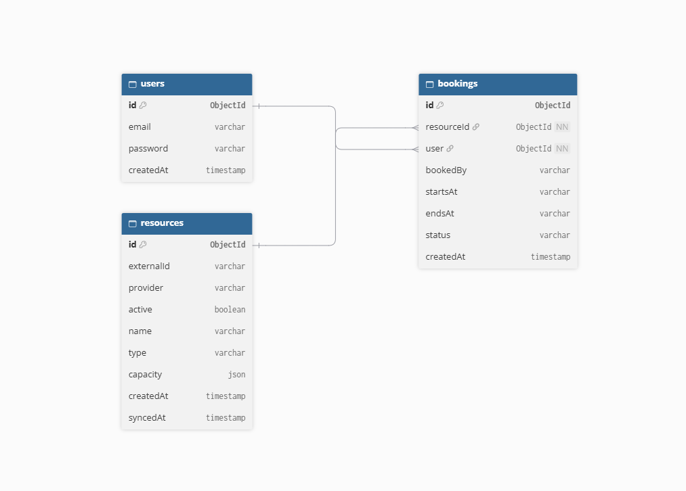
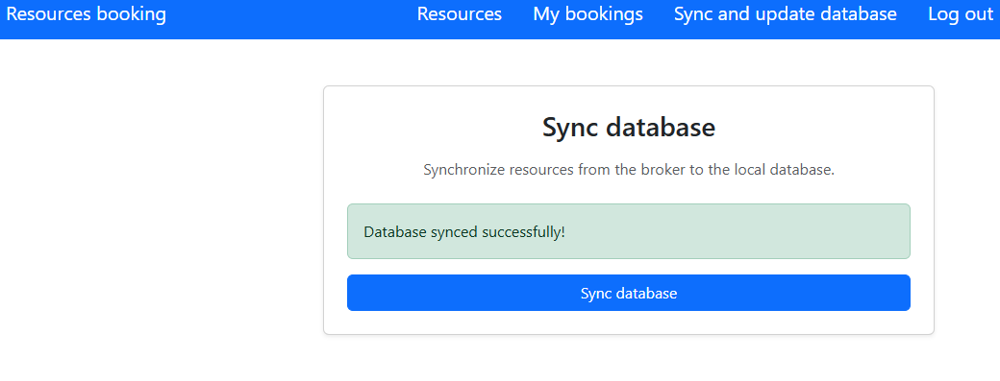
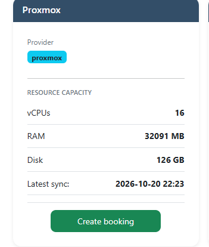

# dv1677-ht26-grupp5-backend

## Gruppmedlemmar

| Namn                 | GitHub        |
| -------------------- | ------------- |
| Rebaz Mohammad Ahmad | rebahama      |
| Tuan Anh Pham        | tuananhpham95 |

## Projektval

Vi har valt bokningssystem resource-booking-ht26

Vi båda två har erfarenhet av liknande projekt och kände att detta var mest passande för oss att jobba med.

## Datamodellering
Följande datamodellering har används för tillfället för projektet:

## Teknikval

**Frontend-ramverk:** React

React kommer att användas eftersom att det finns en stor community och väldigt bra dokumentation, även tidigare erfarenhet av React finns som gör att valet hamnade på React.

## Kör lokalt

1. git clone https://github.com/rebahama/dv1677-ht26-grupp5-backend
2. cd dv1677-ht26-grupp5-backend
3. cp .env.example .env
4. npm install
5. npm start

**Miljövariabler** (se .env.example):

| Variabel                          | Beskrivning                      |
| --------------------------------- | -------------------------------- |
| MONGODB_URI = Din Mongodb databas | Anslutningssträng till MongoDB   |
| PORT=3000                         | Anslutningssträng till npm start |
| JWT_SECRET = Din hemliga kod      | En hemlig kod för att verifiera autentisering |
| BROKER_API_URL = Din broker url   | URL för att kontakta broker      |
| BROKER_GROUP_TOKEN = Hemlig token | Hemlig token kod som broker distribuerar |

## Tester

För att köra tester gör följande:

1. Gå in i root foldern.
2. Starta tester genom att skriva in npm test

### Vad som har testats

Vi har testat 4 olika HTTP metoder,

- GET
- POST
- PUT
- DELETE

Dessa tester har körts på API routerna för att verifiera respons datan ifrån API routerna. Även att kontrollera test databasen för att verifiera all nytilkommen data som skapades med testerna finns i test databasen.

## Driftsatt

- Backend: https://dv1677-spock.nplab.bth.se/resources
- Frontend: https://rebahama.github.io/dv1677-ht26-grupp5-frontend

## Broker integration
Backenden kommunicerar med en mellanhand för att hämta kapaciteter för innehåll och även hålla koll på inventering. Detta sker med hjälp av två stycken miljövariabler:

BROKER_API_URL och BROKER_GROUP_TOKEN. Med hjälp av dessa två värden så kan vi anropa broker och synka våran lokala databas med innehållet ifrån broken.

När resurser synkas till databasen ifrån broker så valdes **alternativ: B. Synka till egen samling.** En url användes "syncresources": "/resources/broker", detta hämtar information ifrån broker och lägger till resurser till den lokala databasen som appen använder.

I frontend finns en knapp när användaren loggar in och klickar på som anropar /resources/broker url. Detta gör att databasen synkas och uppdateras, det finns även en syncAt field i resources databas kollektionen som visar när resurserna synkades sist med tid och datum.

Ifrån frontenden:

### Hur broker används om det ligger nere

När broker ligger nere så används ett HTTP badgateway meddelande, detta kan ses i route/resources.mjs filen i syncAll funktionen. Detta innebär att backenden skickar felmeddelandet till frontenden om något inte skulle fungera.

Användaren kan fortfarande se sparade resurser ifrån den senaste lyckade synkningen. Detta kan ses i route/resources.mjs i getAll funktionen och broker/list routen, här hämtas resource ifrån den lokala databasen. Detta är alltså senaste synkade innehållet som displayas. Den filterar även på att endast visa resurser som är synkade ifrån broker och inte de manuella resurserna som vi själva har lade till tidigare.

### Bokningar till broker

Användaren kan se en lista med resources som hämtas från broker och uppdaterar lokala databasen som sedan exporteras till fronteden där frontenden displayar relevanta resurser. När en användare ska göra en bokning mot resursen så finns följande: Proxmox och Openstack, Vcpu, Ram och disk capacity används med boknings perioden som användaren frågar efter. Detta skickar frontenden till backenden och backenden skickar sedan detta vidare till broker. Broker svarar tillbaka med en success meddelande eller fail beronde på om detta finns tillgänglig hos broker. 

Även MAAS kan bokas, detta skickar endast maskinens system id till brokern, när en bokning har beviljats av broker så sparas detta i den lokala Mongo db databasen som användaren sedan kan se i en egen sida.

### Var sätts BROKER_API_URL och BROKER_GROUP_TOKEN?

Dessa två miljövariabler har satts i Github secrets, dessa används av backend för att kontakta broker och även autentisera gruppen. Dessa variabler är inte synliga i frontend koden utan kan endast få tillgång i backenden genom autentisering via GITHUB secrets.

Detta kan ses i config/broker.mjs filen där den riktiga värden inte skrivs ut och displayas och även i docker-compose.yml filen så exponeras inte hemliga värden.

### Felhanteringar

Om broker inte är tillgänlig fångas detta upp med felmeddelanden som sedan displyas till user beroende på vad för fel detta är. Om en bokning inte är tillgänglig eller om kapaciteten inte räcker till så displyas meddelande för detta.

## Tillvägagångssätt

Dokumentera löpande vad ni gjort och hur ni löst problem.

- Vecka 1: Repot skapades och lades till med Klona + nytt repo, sedan kördes npm install för att installera appen. Alla steg gick bra och applikationen startades upp utan problem. Även npm audit kördes som visade: "3 moderate severity vulnerabilities", npm audit fix lyckades inte fixa dessa 3 stycken vulnerabilites.

- Vecka 2: Implementerade uppdatering av resurs. updateOne lades till i resources.mjs. app.mjs fick PUT /resources/:id och POST /resources/:id så att både API och HTML-formuläret kan spara. Formuläret postar till /resources/:id vid redigering. Knappen “Redigera resurs” lades till på resurssidan. Testat: nytt kan skapas och befintligt kan uppdateras .

- Vecka 3: Gjorde en migrering ifrån SQL till MongoDb, först installerades mongoDB sedan skapades en databas i MongoDb Atlas. Efter detta så gjordes database.mjs filen om till att kunna köra en anslutning till den nya databasen ifrån föregående SQL. Syntaxen för att skapa och rendera datan i den nya databasen gjordes om i booking.mjs filen och resources.mjs, detta för att kunna utföra samma funktioner som tidigare när sql databasen fanns som anslutning. När allt detta var klart så lades samma data som tidigare in i databasen ifrån localhost:3000 gränsnittet och allting fungerade, även i Mongo Db Atlas sidan så kontrollerades att all data fanns på plats. Backend gjordes även om till ett JSON-API: EJS togs bort och alla routes svarar med JSON.

- Vecka 4: Installerade Vitest för att köra själva testerna, Supertest användes till att testa Express API routerna. Även MongoDb memory server användes till att temporärt lägga in test datan istället för att använda sig av produktions databasen. Konfiguerade om i database.mjs filen så att när script test körs då används MongoDb memory och när "npm start" körs då är det produktions databasen som körs. Även server.mjs filen skapades så att när tester körs igång med "npm test" då kommer inte servern att startas igång pga testerna. Backend containeriserades och driftsattes på VPS:en dv1677-spock med Docker, Caddy och GitHub Actions. Flera fel längs vägen (SQLite i imagen, memory-server i produktion, saknad PORT, Atlas-IP) åtgärdades. API:t är nåbart via HTTPS.

- Vecka 5: Allting kontrollerades för att säkerhetsställa att backenden fungerar och returnerar routesen för uppgiften. Även databasen kontrollerades så att inte data hamnar i produktionsdatabasen utan i test databasen.

- Vecka 6: JWT installerades och initierades för att användas för inloggningen och för att skydda olika relevanta routes, curl -i x användes i terminalen för bash genom att kontrollera att rätt användare har behörighet att utföra rätt uppgifter. Exempelvis måste man vara inloggad för att kunna göra en bokning eller radera. Även app.mjs refactoredes om så att den anropar booknings routen, en route folder skapades där crud operationer utfördes för bookningar som sedan i sin tur importerar i från en models folder som skapades till att utföra databas inställningar.

- Vecka 8: Brooker anropas med hjälp av BROKER_API_URL och BROKER_GROUP_TOKEN via VPS, när vi fick tillbaka svar från broker så kunde en get användas för att displaya alla resurser som finns, sedan skapades en sync resurs för att lägga in data ifrån broker till våran mongodb databas. När detta var klart så kunde vi börja använda oss av crud för att lägga in bokningar. Även condition check för MAAS implementerades och även boknings secret döljs ifrån dom olika endpointsen. Även broker variablerna lades in i Github secret variabels och syns inte i frontend koden eller i repot.

- Vecka 9: Databasen görs om till att kunna acceptera nya värden ifrån broker och displaya dessa värden till användaren. Sidan publiceras i backenden så att frontenden kan påbörja arbetet med att skapa bokningar som skickas till broker.